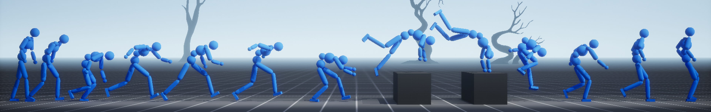

# ADD - Adversarial Differential Discriminator



"Physics-Based Motion Imitation with Adversarial Differential Discriminators"
(https://xbpeng.github.io/projects/ADD/index.html).

---

To train the ADD baseline, use the following command:
```
python mimickit/run.py --arg_file args/add_g1_spinkick_args.txt
```
To train the matched ADD+PDF-HR experiment, append `_PDFHR`:
```
python mimickit/run.py --arg_file args/add_g1_spinkick_PDFHR_args.txt
```
To test an ADD model, run the following command:
```
python mimickit/run.py --arg_file args/add_g1_spinkick_args.txt --mode test --num_envs 4 --visualize true --model_file output/add_g1_spinkick/model.pt
```

## Citation
```
@inproceedings{
	zhang2025ADD,
    author={Zhang, Ziyu and Bashkirov, Sergey and Yang, Dun and Shi, Yi and Taylor, Michael and Peng, Xue Bin},
    title = {Physics-Based Motion Imitation with Adversarial Differential Discriminators},
    year = {2025},
    booktitle = {SIGGRAPH Asia 2025 Conference Papers (SIGGRAPH Asia '25 Conference Papers)}
}
```
